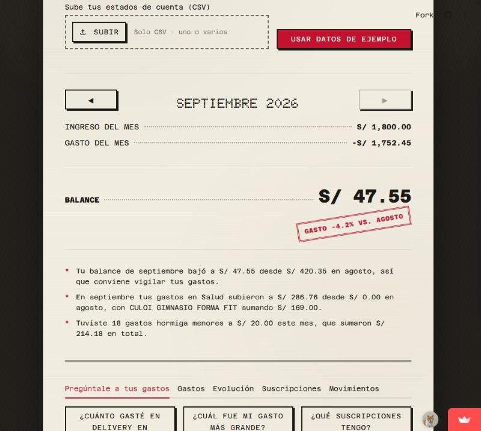
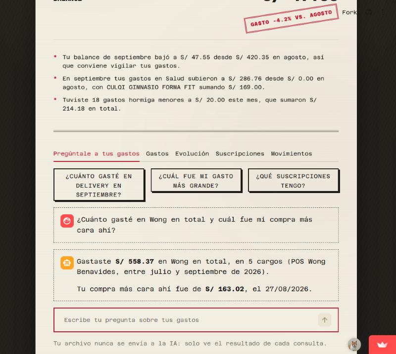
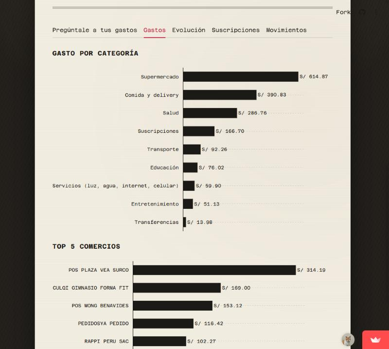
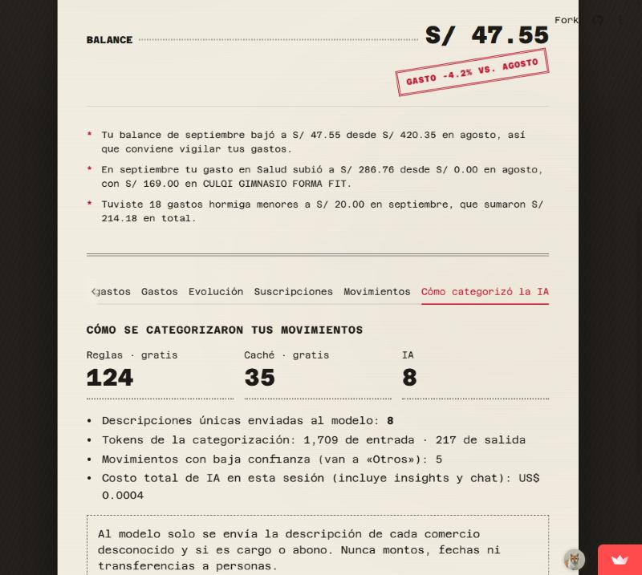
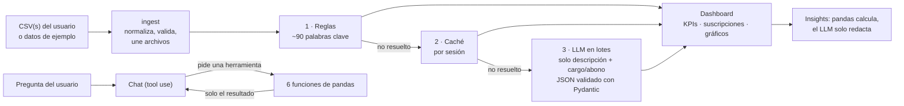

# Mis finanzas · asistente con IA

[](https://github.com/JJva-06/finanzas-ia/actions/workflows/ci.yml)

Sube tu estado de cuenta en CSV y en segundos ves tus gastos **categorizados con IA**, un **resumen del mes** con insights y un **chat** que responde en español sobre tus movimientos.

- **Demo:** https://mis-finanzas-ia.streamlit.app/ — pulsa **"Usar datos de ejemplo"** (no hace falta subir nada).
- **Vista técnica:** https://mis-finanzas-ia.streamlit.app/?tecnico=1 — muestra qué resolvió cada capa, cuántos tokens se gastaron y qué herramientas usó el chat.

No es RAG: el LLM **nunca recibe el estado de cuenta**. Categoriza con **salidas estructuradas** validadas con Pydantic y responde en el chat con **tool use**, llamando a funciones de pandas que hacen los cálculos.

> Proyecto de portafolio. Los datos de ejemplo son 100% sintéticos y la app no da asesoría financiera.

## Capturas

| Resumen del mes | Chat |
|---|---|
|  |  |
| **Gastos por categoría y top 5 comercios** | **Vista técnica: cómo se categorizó** |
|  |  |

## Arquitectura



| Módulo | Qué hace |
|---|---|
| [`src/ingest.py`](src/ingest.py) | Lee el CSV, detecta el formato de fecha, limpia descripciones, une varios archivos sin duplicar días |
| [`src/categorize.py`](src/categorize.py) | Reglas → caché → LLM, con reintento de lo que no validó y tope de descripciones |
| [`src/llm.py`](src/llm.py) | Cliente de Anthropic: errores amigables, reintentos del SDK, conteo de tokens y costo |
| [`src/insights.py`](src/insights.py) · [`src/narrativa.py`](src/narrativa.py) | KPIs, suscripciones y hechos del mes; el LLM los redacta y se verifica que no invente números |
| [`src/chat.py`](src/chat.py) | Bucle de tool use con 6 herramientas y límite de 5 consultas por pregunta |
| [`scripts/evaluate.py`](scripts/evaluate.py) | Evaluación de la categorización y del chat |

## Decisiones técnicas y por qué

- **Categorización en tres capas para controlar el costo.** Las reglas resuelven gratis los comercios conocidos; la caché reutiliza lo que el LLM ya resolvió en la sesión; y al LLM solo llegan **descripciones únicas** que nadie más pudo resolver. Con el archivo de ejemplo: 124 movimientos por reglas, 35 por caché y 8 por el LLM, en **una sola llamada**.
- **Tool use en vez de mandar el CSV al LLM.** El modelo elige una herramienta (`gasto_por_categoria`, `top_gastos`, `buscar_transacciones`…) y el código la ejecuta en pandas. Los números siempre salen de pandas, y el modelo solo ve el resultado de cada consulta, nunca el archivo. Solo se ejecutan funciones de un diccionario fijo: nada de `exec` ni `eval`.
- **Salidas estructuradas con Pydantic.** La categoría es un enum, así que el modelo no puede inventar categorías. Pydantic valida lo que el esquema no garantiza (ids completos y sin repetir, confianza entre 0 y 1). Lo que no valida se reintenta una vez y, si vuelve a fallar, va a `Otros`.
- **Minimización de datos.** Para categorizar, al LLM solo se envían la descripción y si es cargo o abono: nunca montos, fechas ni transferencias a personas. Las herramientas del chat devuelven resúmenes por defecto; las filas individuales salen de una herramienta aparte, con un máximo de 10.
- **Confianza y "no sé".** Si el modelo reporta una confianza de 0.5 o menos, la transacción va a `Otros` en lugar de usar una categoría adivinada.
- **Los insights no inventan números.** Pandas calcula los hechos, el LLM los redacta, y un control verifica que cada número del texto esté en sus datos. Si no está, se usa una plantilla.
- **La app funciona sin IA.** Sin API key, o con la API caída, las reglas y las plantillas siguen funcionando, y la UI muestra un aviso.
- **Datos sintéticos.** El repo es público: [`scripts/generate_sample.py`](scripts/generate_sample.py) genera un estado de cuenta reproducible (semilla fija) con comercios de Lima. Un test verifica que el archivo del repo coincida con la semilla.
- **El usuario ve un producto, no un prototipo.** Las métricas internas viven en la [vista técnica](https://mis-finanzas-ia.streamlit.app/?tecnico=1), a un clic, sin ensuciar la vista principal.

## Costos medidos (Claude Haiku 5.5)

| Operación | Costo |
|---|---|
| Categorizar el archivo de ejemplo (167 movimientos, 1 llamada) | US$ 0.0003 |
| Una pregunta en el chat | US$ 0.0003 – 0.0006 |
| Evaluación completa (3 corridas de categorización y chat) | US$ 0.02 |

Con US$ 5 alcanza para unas 18,000 demos de categorización. Para proteger el saldo de la demo pública, se envían como máximo 100 descripciones únicas por carga (las más frecuentes) y los archivos pueden pesar hasta 20 MB.

## Evaluación

Se corre con `uv run python scripts/evaluate.py`. Resultados completos: [`data/eval/resultados.md`](data/eval/resultados.md).

### Cómo se armó

- **100 transacciones etiquetadas**: 50 de comercios del catálogo del generador y **50 fuera del catálogo** (comercios que el sistema nunca vio, para medir al LLM con una muestra que signifique algo).
- **Las etiquetas las puso otra IA** ([prompt](data/eval/prompt_etiquetado.md)), distinta a la que categoriza y **sin** las definiciones de categoría del prompt del sistema, para que el LLM no "acierte" por coincidir con quien escribió su prompt. Después **las revisé a mano**: corregí **8 de 100** que contradecían la definición del proyecto (dinero entre personas = `Transferencias`, no `Ingresos`).
- **3 corridas**, porque el LLM no es determinista: se reporta el promedio y el rango.

### Categorización

| Métrica | Accuracy |
|---|---|
| **Global** | **90.3%** (89.0–91.0%) |
| Global sin las 20 ambiguas | 94.6% (93.8–95.0%) |
| Comercios del catálogo (n=50) | 94.0% |
| **Fuera del catálogo (n=50)** | **86.7%** (84.0–88.0%) |
| Capa reglas (n=56) | 91.1% |
| **Capa LLM (n=38)** | **87.7%** (84.2–89.5%) |
| Capa caché (n=6) | 100% |

<details>
<summary>Por categoría y errores de la 1.ª corrida</summary>

| Categoría | n | Accuracy |
|---|---|---|
| Comida y delivery | 28 | 85.7% |
| Transferencias | 12 | 91.7% |
| Suscripciones | 11 | 81.8% |
| Otros | 9 | 100.0% |
| Entretenimiento | 8 | 87.5% |
| Transporte | 8 | 100.0% |
| Supermercado | 7 | 100.0% |
| Servicios (luz, agua, internet, celular) | 6 | 83.3% |
| Salud | 6 | 100.0% |
| Educación | 4 | 100.0% |
| Ingresos | 1 | 100.0% |

| Descripción | Esperada | Predicha | Capa | Ambigua |
|---|---|---|---|---|
| TAMBO+ LARCO (×3) | Comida y delivery | Supermercado | reglas | sí |
| OXXO BENAVIDES | Comida y delivery | Supermercado | reglas | sí |
| CULQI*PLATZI SUBSCR | Suscripciones | Educación | reglas | no |
| CULQI*SMARTFIT MEMBRESIA | Suscripciones | Salud | llm | no |
| CRISOL OVALO GUTIERREZ | Entretenimiento | Otros | llm | sí |
| JUNTA PROPIETARIOS EDIFICIO | Servicios | Otros | llm | no |
| BIM-ROBERTO GOMEZ | Transferencias | Otros | llm | no |

</details>

### Chat

**15/15 respuestas correctas en las 3 corridas.** Son 12 preguntas con respuesta numérica, verificadas contra pandas por un test, y **3 que no se pueden responder** (un mes sin datos, el tipo de cambio de hoy, una recomendación de inversión): en las tres el asistente dice que no puede responder, sin inventar cifras.

### Límites (lo que estos números no dicen)

- **`Ingresos` quedó con una sola transacción** después de corregir las etiquetas: esa categoría no está medida de verdad.
- **Las preguntas del chat las escribió Claude** y son directas: falta probar preguntas ambiguas o de varios pasos. La calificación verifica que aparezca el número esperado, no que no haya otro número equivocado.
- **La capa LLM varía entre corridas** (84–90%).
- **Errores conocidos:** Tambo y Oxxo son ambiguos (¿súper o comida?); la regla `PLATZI → Educación` le gana a la señal de suscripción; el prompt clasifica los gimnasios como `Salud`; la billetera BIM no está en las reglas.
- Las devoluciones están fuera de alcance: suman al ingreso y al gasto, aunque el balance queda bien.

## Cómo correrlo localmente

Requiere [uv](https://docs.astral.sh/uv/) y Python 3.11.

```bash
git clone https://github.com/JJva-06/finanzas-ia.git
cd finanzas-ia
uv sync
cp .env.example .env   # agrega tu ANTHROPIC_API_KEY (opcional: sin ella funciona con reglas y plantillas)
uv run streamlit run app.py
```

```bash
uv run pytest -q                          # 170 tests; los del LLM usan dobles, no llaman a la API
uv run python scripts/evaluate.py         # evaluación real (usa la API, ~US$ 0.02)
uv run python scripts/generate_sample.py  # regenera el archivo de ejemplo
```

El CSV necesita las columnas `fecha, descripcion, monto` (cargos en negativo). Opcionalmente, `moneda` (PEN o USD).

## Próximos pasos

- Leer estados de cuenta en **PDF** (`pdfplumber`).
- **Multimoneda** real, con tipo de cambio por fecha.
- **Presupuestos con alertas** por categoría.
- Corregir los errores conocidos de la evaluación y ampliar las preguntas del chat a casos de varios pasos.

## Stack

Python 3.11 · uv · Streamlit · pandas · Plotly · Anthropic SDK (Claude Haiku 5.5) · Pydantic · pytest · ruff · GitHub Actions
